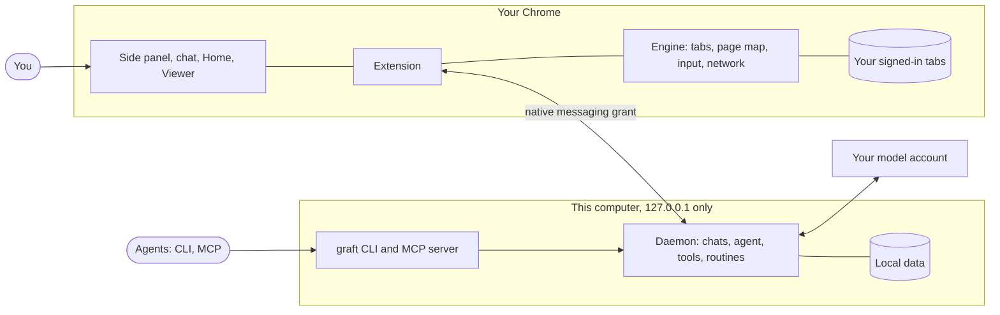

# Graft

**Graft is a compiling browser runtime and CLI for humans and agents.** Use it directly inside your real Chrome (side panel, full chat, and Pi's built-in coding, file and shell tools), or call it from any agent over the CLI or MCP.

It does not run in a sandbox, a cloud VM or a headless copy. It drives the Chrome you already use, signed in to everything, in background tabs you can watch or take over.

## What it does

**1. Sites compile into APIs.** The first run explores a site and records the private API its own page calls. Graft compiles that into a typed ability. Later runs replay it at rung 0: no model, milliseconds, $0. When the site shifts, the replay notices and heals the mapping instead of failing. Mapped sites export as OpenAPI or MCP.

```sh
graft map https://shop.example  # record a flow once, build its API
graft ops shop.example          # what it can do, with typed inputs
graft call shop.example search '{"q":"iphone 16"}'
graft heal shop.example --repair # probe every operation for drift, sign-out or a bot wall
```

**2. Real Chrome, real sessions, clean handoff.** A native extension in your own Chrome profile. Input is real input events, paced and curved like a person's. Interstitial checks are waited out passively. When a check or a login really needs you, Graft takes a `widgetShot` of the widget and returns a structured `humanHandoff` instead of guessing. Passwords and one-time codes are filled from your password manager inside the browser; the model is only told that you are signed in.

**3. Watchers and boosts.** "Tell me when it's back in stock" becomes a scheduled check that runs as plain code and wakes the model only when the condition is met. Boosts are lasting changes to a site ("hide Shorts", "add a price-per-kg column"), managed under Settings → Site customizations.

**4. Proof receipts and the recorder.** Every answer carries a receipt of what was actually read and done, so a result can be checked rather than trusted. `graft record` captures a run as an editable folder (clip, per-tab takes, `events.json`) for demos and bug reports.

**5. File and diff viewer.** Click any file or diff link in chat and it opens in one reusable Viewer tab: syntax view with jump-to-line, rendered Markdown / CSV / HTML preview next to the raw source, inline diffs, copy-path, and a strip of recently opened files.

**6. CLI and MCP bridge.** Everything the chat can do, a terminal or another agent can do.

```sh
graft run "Find the cheapest iPhone 16 128GB on Amazon.in" --json
graft run --file tasks.txt --parallel 5
graft abilities            # list, run, test, version and publish saved abilities
graft doctor               # check every piece; names the one fix if something is missing
graft login                # connect a model account
graft mcp                  # stdio MCP server
```

The MCP server exposes `browser_code`, `browser_tabs`, `browser_context`, `crawl`, `site_mapper` and `extract` (the same tools Graft's chats use; calls with the same `session` share variables, tabs and files), plus `graft_run`, `graft_run_status`, `graft_result` and `graft_trace` to hand Graft a whole task. When the client supports MCP sampling, Graft can use the client's model for its own calls (`graft settings set mcpUseClientModel=true`).

## Install

| OS                   | One-line install                                                                          |
| -------------------- | ----------------------------------------------------------------------------------------- |
| Windows (PowerShell) | `irm https://raw.githubusercontent.com/gillasg/aeon-browser/main/install.ps1 \| iex`      |
| macOS / Linux        | `curl -fsSL https://raw.githubusercontent.com/gillasg/aeon-browser/main/install.sh \| sh` |

The installer builds Graft, installs the background service and the `graft` command, then runs `graft setup`, which opens `chrome://extensions` with the extension folder on your clipboard. Chrome requires three clicks, once:

1. Turn on **Developer mode** (top right).
2. Click **Load unpacked**.
3. Paste the folder (Ctrl+V / Cmd+V) and choose it.

No Chrome flags are needed. Re-run the install command to update; your data is kept. Chrome shows a _Disable developer mode extensions_ banner for any unpacked extension; dismiss it and leave Developer mode on.

- Data lives in `~/.local/share/graft` (Linux), `~/Library/Application Support/Graft` (macOS) or `%LOCALAPPDATA%\Graft` (Windows).
- Linux: `sudo loginctl enable-linger "$USER"` keeps the service running while you are logged out (optional).
- Custom `--user-data-dir`: copy `com.graft.native_host.json` from the default profile into `<user-data-dir>/NativeMessagingHosts/`.
- From a clone: `node scripts/setup.mjs`. By hand: `pnpm install --ignore-scripts`, `pnpm build`, `node apps/native-host/scripts/install.mjs`, then load `apps/chrome-extension/native-dist`.

Setup also installs a Graft skill in `~/.agents/skills` and `~/.claude/skills`, so agents on this machine find it from their shell (`graft tools`, `graft tool browser_code '{...}' --session s`). `graft install` sets it up again.

## Measured

Each release runs against our own eval suite: real tasks on local copies of real sites, graded by the final state of the page, not by asking a model how it went.

| Suite (Nov 2026)                                                                         | Result                                   |
| ---------------------------------------------------------------------------------------- | ---------------------------------------- |
| Lane A: 23 everyday tasks (shopping, forms, sign-in, inboxes, watchers)                  | **18/23 (78%)**, $0.93 model cost for 23 |
| Bot detectors: BrowserScan, CreepJS, Cloudflare, DataDome, HUMAN, Fingerprint, Sannysoft | **6 of 7 decided pass**                  |
| First-tool choice across 115 situations (×3)                                             | 43% first call, 49% within 3 steps       |

Lane A failures cluster on timing-critical watcher tasks ("grab tickets the second they open"). Sannysoft fails only on WebGL, because the test machine has no GPU. Details in [docs/evals.md](docs/evals.md); model-free benches in [benchmarks/](benchmarks/README.md).

## How it works



- **The agent writes code, not clicks.** It runs short scripts against a Playwright-style API in a sandboxed realm, so a whole form or a 50-row table is one step.
- **Extension:** the UI and the engine. The engine drives tabs through Chrome's debugger API with a compact page map, real input events, iframes, network capture and replay.
- **Daemon:** each chat's agent loop, the tools, routines and watchers, and local storage.

```
apps/
  daemon            chats, the agent, every tool it runs
  cli               the graft command and MCP server
  native-host       connects Chrome to the daemon
  chrome-extension  side panel, chat, Home, Viewer, cursor
packages/
  protocol          Graft's messages
  pi-adapter        Pi sessions, browser tools, guidance
  domain, store     chat state and local storage
  ui                the shared React UI
browser/            engine, site API, crawl, boosts and the browser CLI; builds first
benchmarks/         kernel, chaos, stealth and installed-host benches
```

## Local connections

The daemon listens on `127.0.0.1` only. The extension socket (`/graft/v1`) accepts a connection only when its `Origin` is this install's `chrome-extension://` id; any other origin, including a web page, gets `ORIGIN_NOT_ALLOWED`. The first message must carry a connection grant minted for that extension, delivered by the native messaging host (`com.graft.native_host`), which expires and is checked with a constant-time compare. A page cannot open the native host, mint a grant or complete the handshake. The CLI socket (`/core/v1`) accepts only clients that send no `Origin`. The grant is not a prompt: Graft never asks permission to run.

## License

See [LICENSE](LICENSE).
