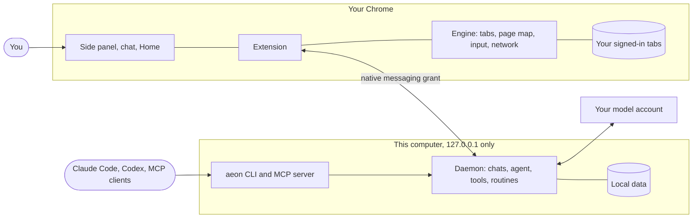

# Aeon

**A browser agent that lives in your own Chrome.** It works in the browser you already use, signed in to everything, next to you. It doesn't run in a sandbox, a cloud VM or a headless copy.

Ask in plain words: _"find the cheapest iPhone 16 on Amazon.in"_, _"tell me when this drops under ₹2000"_, _"fill this form from my details"_. Aeon does it in a background tab you can watch or take over.

## What makes it different

- **Any website becomes an API.** Aeon learns the private API a site's own page uses, from your real session, then calls it directly. A task that takes minutes of clicking runs in seconds. When the site changes, the mapping repairs itself. It exports as OpenAPI or MCP.
- **Signs in without the model seeing your password.** Logins, one-time codes and personal details are filled from your password manager inside the browser. The model is only told that you are signed in.
- **Watchers that cost nothing until something happens.** "Tell me when it's back in stock" becomes a scheduled check that runs without a model call and wakes the agent only when the condition is met. Snipes act within milliseconds of a sale opening.
- **Uses the AI subscriptions you already pay for.** It can run on your existing model account, and it can use AI websites through your own logins with no API key.
- **Your browser, shared.** You and several agents work in one Chrome at once. Each agent keeps to its own tab group, and you can take over any tab at any time.
- **Abilities that get faster every run.** One sentence or one demonstration becomes a named, tested skill for a site that is safe to repeat.
- **Change any site by asking.** "Hide Shorts on YouTube" or "add a price-per-kg column" becomes a lasting change to how the site looks and behaves.
- **Hard to tell from a person.** It passes the common bot detectors (see the numbers below).
- **Other agents can use it.** Claude Code, Codex or any MCP client can hand Aeon a whole task or drive your browser directly.

## Measured, not claimed

Every release is run against our own eval suite: real tasks on local copies of real sites, graded by checking the final state of the page, not by asking a model whether it went well. Failures are listed, not hidden.

| Suite (Grok 4.7, Nov 2026)                                                               | Result                                                   |
| ---------------------------------------------------------------------------------------- | -------------------------------------------------------- |
| Lane A: 23 everyday tasks (shopping, forms, sign-in, inboxes, watchers)                  | **18/23 (78%)**, at $0.93 in model list price for all 23 |
| Bot detectors: BrowserScan, CreepJS, Cloudflare, DataDome, HUMAN, Fingerprint, Sannysoft | **6 of 7 decided pass**                                  |
| First-tool choice across 115 situations (×3)                                             | 43% first call, 49% within 3 steps                       |

All three Lane A failures are timing-critical watcher tasks ("grab tickets the second they open"). That is the next thing we are fixing. Sannysoft fails only on WebGL, because the test machine has no GPU. More detail in [docs/evals.md](docs/evals.md).

## How it works



- **Extension (in Chrome):** the chat UI and the engine. The engine drives tabs through Chrome's debugger API with a compact page map, real input events, iframes, network capture and replay.
- **Daemon (on your machine):** runs each chat's agent loop and the tools (`browser_code`, `crawl`, `site_mapper`, routines), and keeps everything in local storage. It listens on localhost only, and only your extension can connect (see _Local connections_ below).
- **The agent writes code, not clicks.** It works by writing short scripts against a Playwright-style API inside a sandbox, so a whole form or a 50-row table is one step, not 50.
- **Routines and watchers** run on the daemon's schedule as plain code, and call the model only when there is something to act on.

## Install

One command installs Aeon; `aeon setup` (which the installer already runs) then guides you through the only step Chrome requires. Aeon builds itself, installs the background service and the `aeon` command, opens `chrome://extensions` and puts the extension folder on your clipboard. In that Chrome tab:

1. Turn on **Developer mode** (top right).
2. Click **Load unpacked**.
3. Paste the folder (Ctrl+V / Cmd+V) and choose it.

Aeon notices the connection, opens its Chat and shows one line about itself with three example tasks. **No Chrome flags are needed**: a normal Chrome launch works. `aeon doctor` checks each piece and names the one fix if something is missing; `aeon setup` repeats the guided steps any time. Re-run the install command to update — the three clicks are needed only once.

| OS                   | One-line install                                                                          |
| -------------------- | ----------------------------------------------------------------------------------------- |
| Windows (PowerShell) | `irm https://raw.githubusercontent.com/gillasg/aeon-browser/main/install.ps1 \| iex`      |
| macOS / Linux        | `curl -fsSL https://raw.githubusercontent.com/gillasg/aeon-browser/main/install.sh \| sh` |

Chrome shows a _Disable developer mode extensions_ banner whenever an extension is loaded from a folder instead of the Chrome Web Store. Aeon is not in the store; dismiss the banner and leave Developer mode on. On Linux, `sudo loginctl enable-linger "$USER"` is optional: it keeps the service running while you are logged out.

Aeon keeps its files in the data folder (`~/.local/share/aeon` on Linux, `~/Library/Application Support/Aeon` on macOS, `%LOCALAPPDATA%\Aeon` on Windows). Updates keep that data. If you start Chrome with a custom `--user-data-dir`, copy `com.aeon.native_host.json` from the default profile into `<user-data-dir>/NativeMessagingHosts/` too.

From a clone instead: `node scripts/setup.mjs` does the same from this folder. By hand: `pnpm install --ignore-scripts`, `pnpm build`, then `node apps/native-host/scripts/install.mjs`, and load `apps/chrome-extension/native-dist` in Chrome. The daemon (`apps/daemon`) supplies Pi sessions, the agent and local storage; the extension supplies the side panel, chat and browser control. Run `pnpm start` for a standalone daemon, or use the installed login service.

## What is in this repo

```
apps/
  daemon          the brain: Pi sessions, chats, the agent, every tool it runs
  cli             the aeon command and MCP server for outside agents
  native-host     connects Chrome to the daemon
  chrome-extension  the face: side panel, chat, new tab, orb
packages/
  protocol        Aeon's messages (re-exporting the engine's)
  pi-adapter      Pi sessions, browser tools, guidance
  domain, store   chat state and local storage
  ui              the shared React UI
```

Everything browser-related lives in `browser/`: the engine (browser control), the protocol, the tools, boosts, the site API, the crawl tool and the command line Aeon's CLI builds on. It is part of this workspace and builds first.

## Local connections

The daemon listens on `127.0.0.1` only. The extension socket is `/aeon/v1`: a connection is accepted when its `Origin` is this install's `chrome-extension://` id, and any other origin, including a web page, is rejected (`ORIGIN_NOT_ALLOWED`). The first message must carry a connection grant minted for that extension, which expires and is checked with a constant-time compare. Chrome delivers the grant through the native messaging host (`com.aeon.native_host`), which Chrome starts for the extension and which itself refuses a caller whose origin is not that extension. A page cannot open the native host, cannot mint a grant, and cannot complete the handshake. The CLI socket (`/core/v1`) accepts only a client that sends no `Origin`. The grant is not a user prompt: Aeon does not ask permission to run.

## CLI and MCP

`pnpm aeon <command>` (or `node apps/cli/dist/cli.js`) drives the running Aeon from a terminal or another agent. Each task becomes a full Aeon chat, opened as a background tab in Chrome so you can watch it.

```sh
pnpm aeon run "Find the cheapest iPhone 16 128GB on Amazon.in"
pnpm aeon run --file tasks.txt --parallel 5   # one task per line, or a JSON array
pnpm aeon chats
pnpm aeon result <chatId>
pnpm aeon trace <chatId>
```

`run` options: `--quiet` (no chat tabs), `--model provider/id`, `--thinking level`, `--timeout minutes`, `--json`. Each run saves a report under `cli-runs/` in the data directory.

## Outside agents

Setup also installs an `aeon` command and an Aeon skill (in `~/.agents/skills` and `~/.claude/skills`), so agents on this machine know Aeon exists and can use it from their shell: `aeon tools` lists the tools with their guidance, `aeon tool browser_code '{...}' --session s` runs one, `aeon run "task"` hands Aeon a whole task. `aeon install` sets this up again.

Other agents (Claude Code, Codex, any MCP client) can use Aeon two ways through its MCP server (`node apps/cli/dist/cli.js mcp`):

- **Hand Aeon a task**: `aeon_run`, then `aeon_run_status` / `aeon_result` / `aeon_trace`.
- **Drive the browser themselves**: `browser_code`, `browser_tabs`, `crawl` and `site_mapper`, the same tools Aeon's chats use. Calls with the same `session` share variables, tabs and files.

When your agent supports MCP sampling, Aeon uses its model for Aeon's own calls if you have no Aeon model signed in; set `aeon settings set mcpUseClientModel=true` to always prefer it (no Aeon model key needed).
